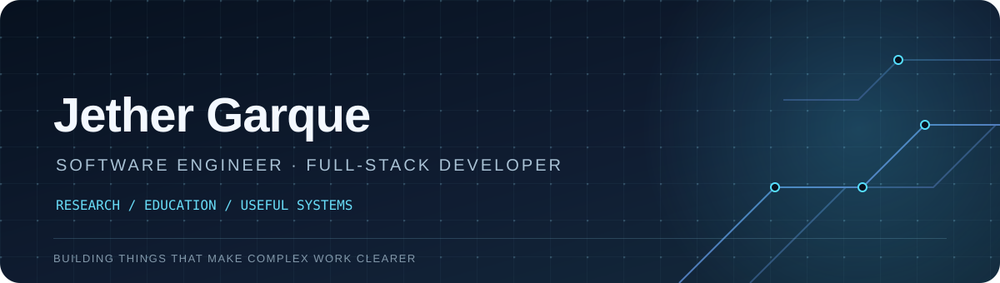
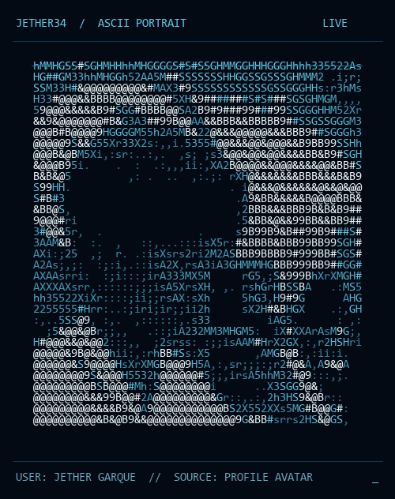
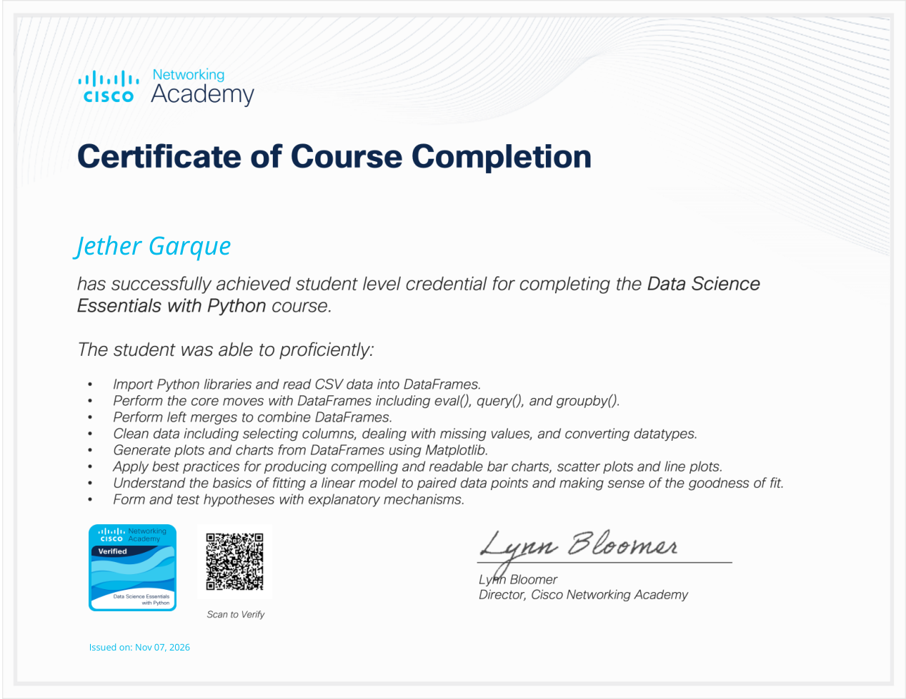
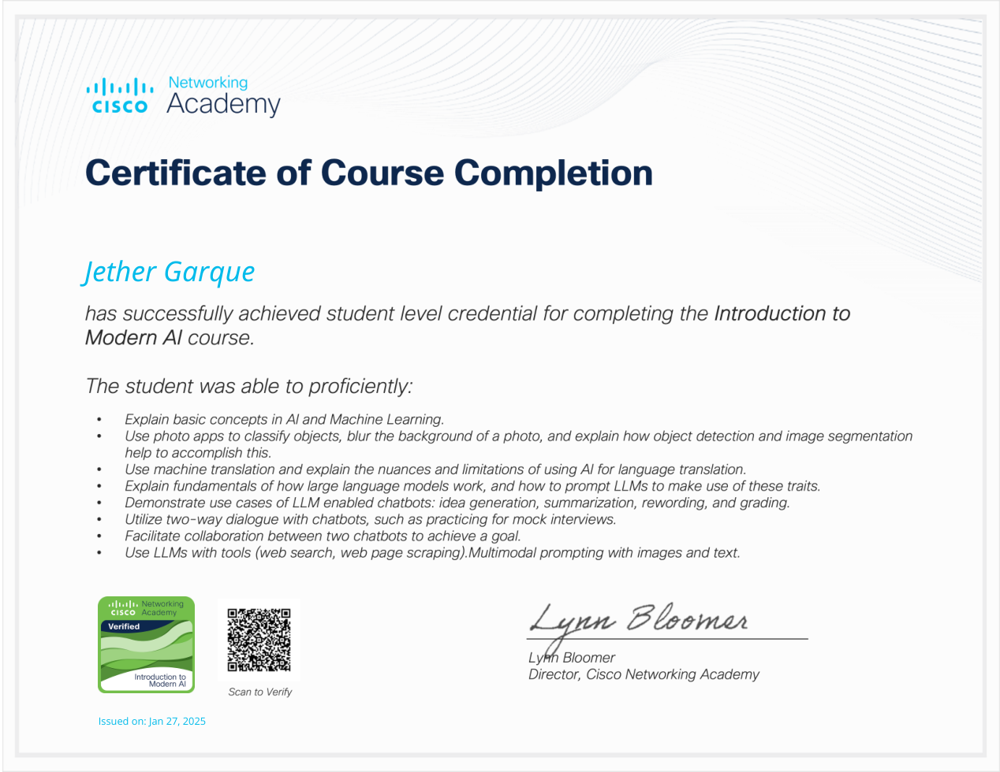
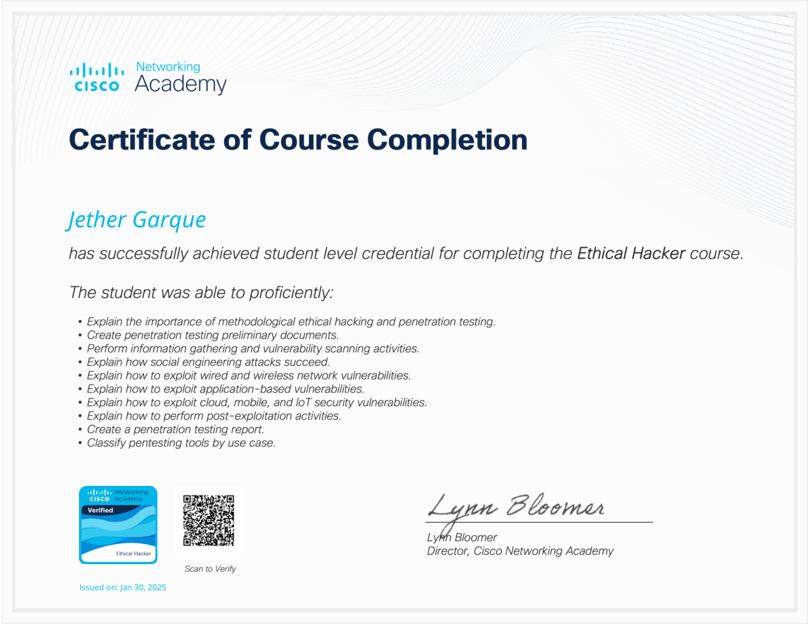
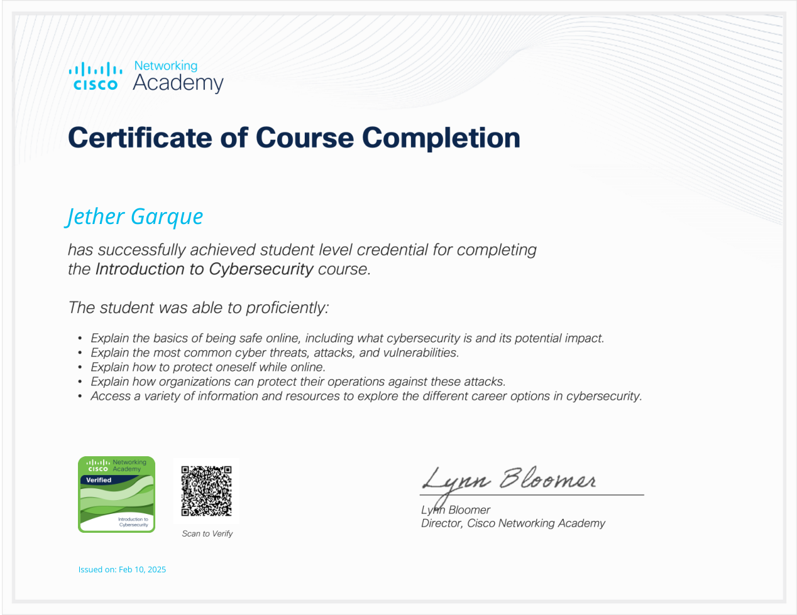
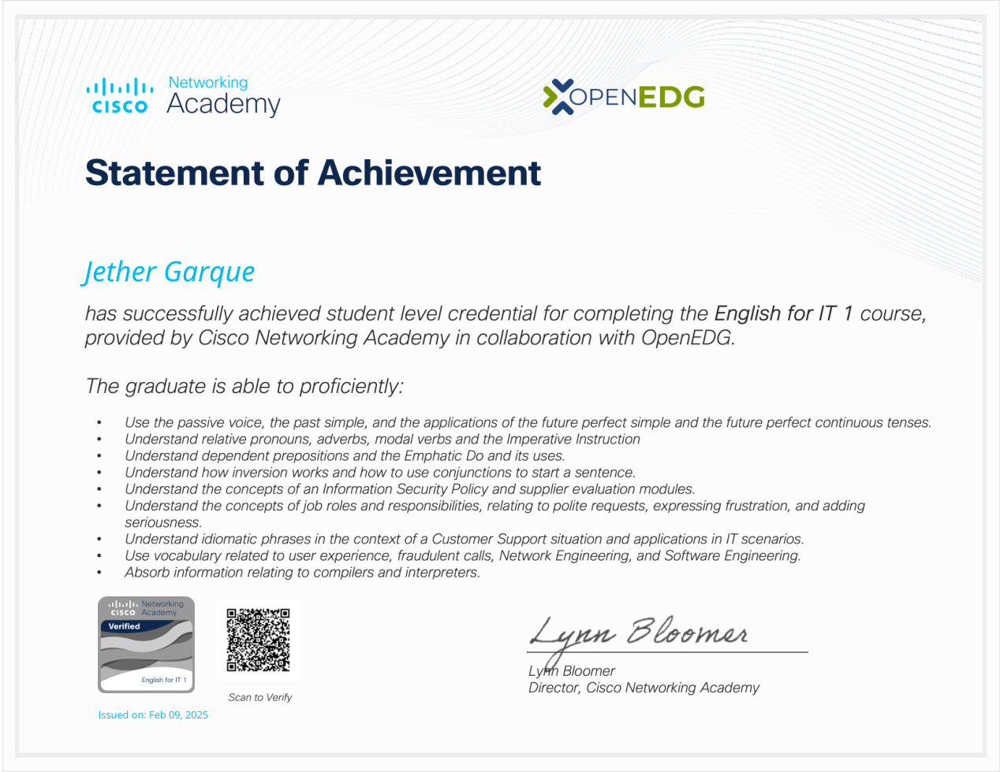

<table><tr>
<td width="72%"></td>
<td width="28%"></td>
</tr></table>

### SOFTWARE ENGINEER | FULL-STACK DEVELOPER | PHILIPPINES

**I build practical software for research, education, and everyday operations.**

[Portfolio](https://lingering-wave-20b9.garquejether681.workers.dev/) | [Credly](https://www.credly.com/users/jether-garque/badges/credly) | [Projects](#selected-work) | [Contact](#connect)

---

## Featured projects

<table>
<tr>
<td width="50%" valign="top">
<h3><a href="https://github.com/Jether34/Mathevo">Mathevo</a></h3>

Cross-platform mathematics workspace for calculation, lessons, and interactive visualizations.

<code>Flutter</code> <code>Dart</code> <code>SQL</code>

</td>
<td width="50%" valign="top">
<h3><a href="https://github.com/Jether34/CCOverT">CCOverT</a></h3>

Coral-cover research workspace for Puerto Princesa, Palawan, with analysis, prediction, and reporting.

<code>React</code> <code>TypeScript</code> <code>FastAPI</code> <code>MongoDB</code>

</td>
</tr>
<tr>
<td width="50%" valign="top">
<h3><a href="https://github.com/Jether34/WeeWare-">WeeWare</a></h3>

Data-driven forecasting project for mango pulp weevil infestation using climate and weather inputs.

<code>Python</code> <code>LASSO</code> <code>scikit-learn</code>

</td>
<td width="50%" valign="top">
<h3><a href="https://github.com/Jether34/Sysnnova">Sysnnova</a></h3>

School grade management platform for Philippine senior high schools, with web, Android, and desktop clients.

<code>React</code> <code>Node.js</code> <code>MongoDB</code> <code>Electron</code> <code>Capacitor</code>

</td>
</tr>
</table>

[Explore more projects](https://lingering-wave-20b9.garquejether681.workers.dev/#projects)

## Certificates

**Cisco Networking Academy** - Select a certificate preview to open the original PDF.

<table>
<tr>
<td width="50%" align="center"> <strong>Data Science Essentials with Python</strong> Issued November 7, 2026</td>
<td width="50%" align="center"> <strong>Introduction to Modern AI</strong> Issued January 27, 2025</td>
</tr>
<tr>
<td width="50%" align="center"> <strong>Ethical Hacker</strong> Issued January 30, 2025</td>
<td width="50%" align="center"> <strong>Introduction to Cybersecurity</strong> Issued February 10, 2025</td>
</tr>
<tr>
<td colspan="2" align="center"> <strong>English for IT 1</strong> Issued February 9, 2025</td>
</tr>
</table>

[View my Credly credentials](https://www.credly.com/users/jether-garque/badges/credly)

## Achievements

- Completed Cisco Networking Academy credentials across data science, AI, cybersecurity, networking, Python, JavaScript, and Linux.
- Participated in AWS Community Day Manila 2026.

## When I code, I rely on

**Languages**

**AI and data**

**Frontend and mobile**

**Backend, databases, and tools**

## Connect

[Portfolio](https://lingering-wave-20b9.garquejether681.workers.dev/) | [GitHub](https://github.com/Jether34) | [Credly](https://www.credly.com/users/jether-garque/badges/credly) | [LinkedIn](https://www.linkedin.com/in/jether-garque)
